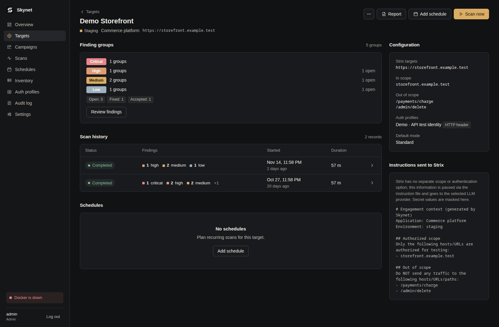
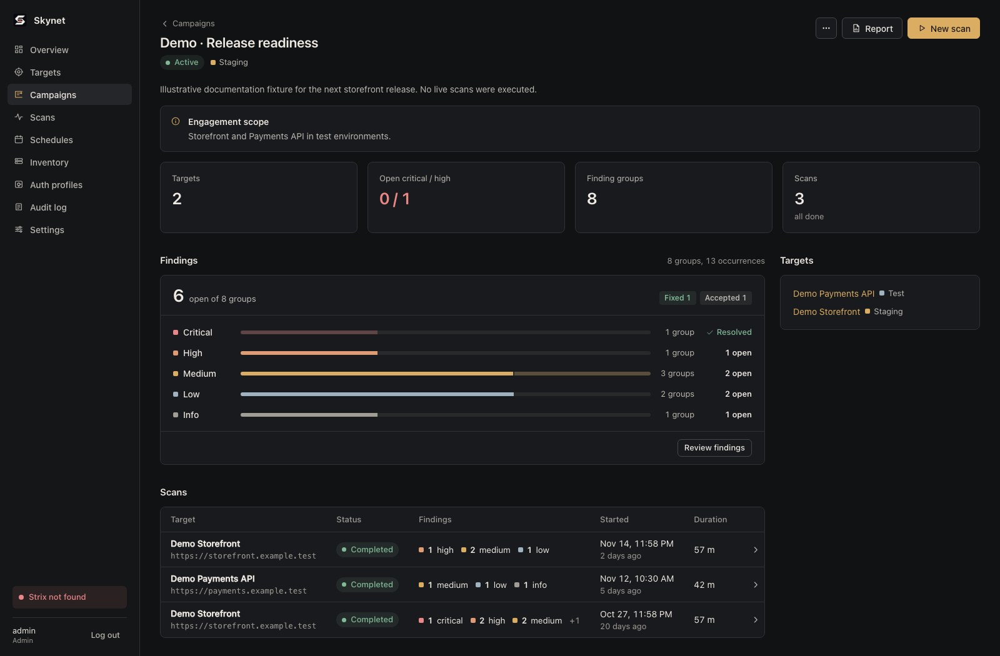
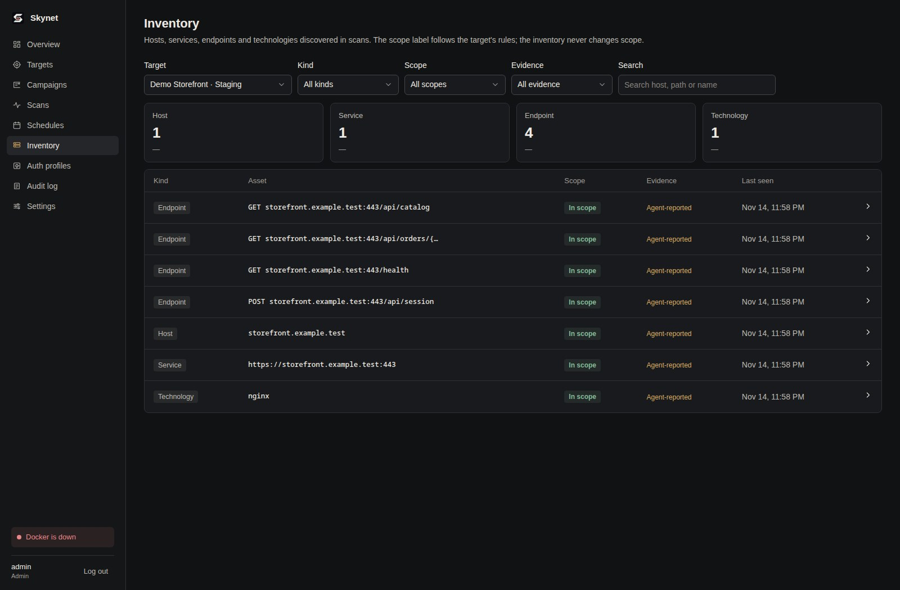
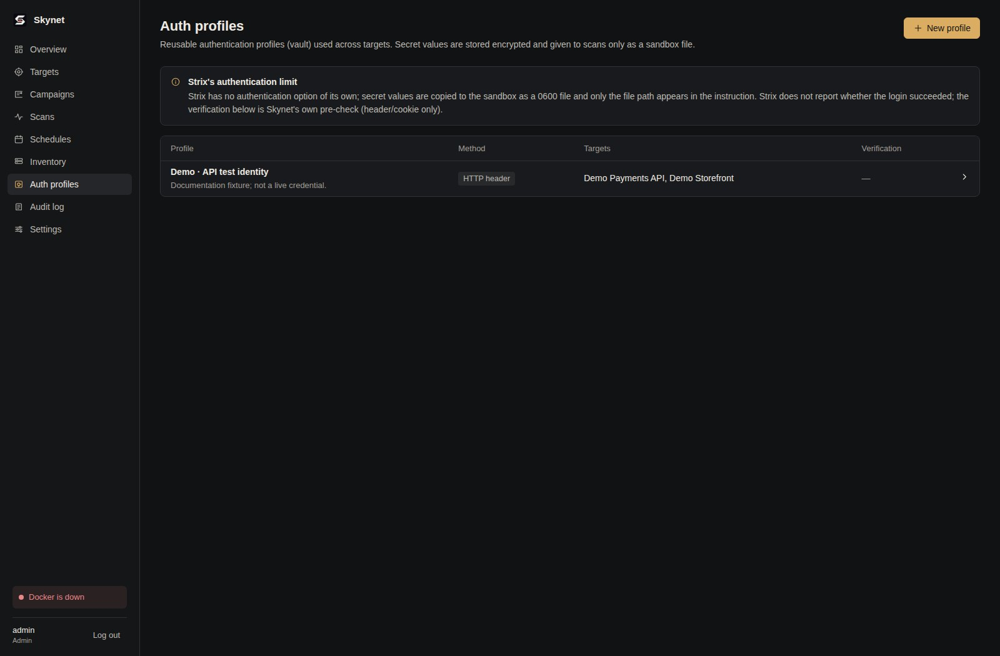
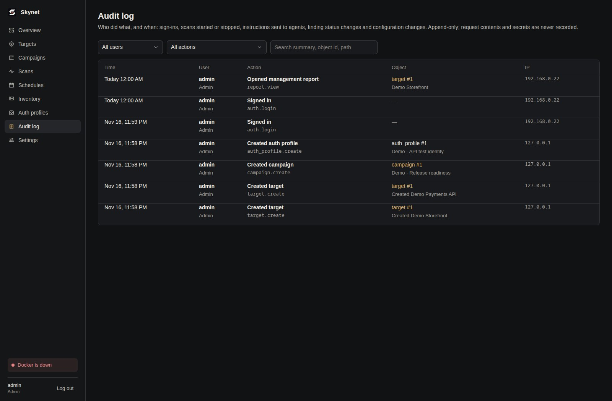
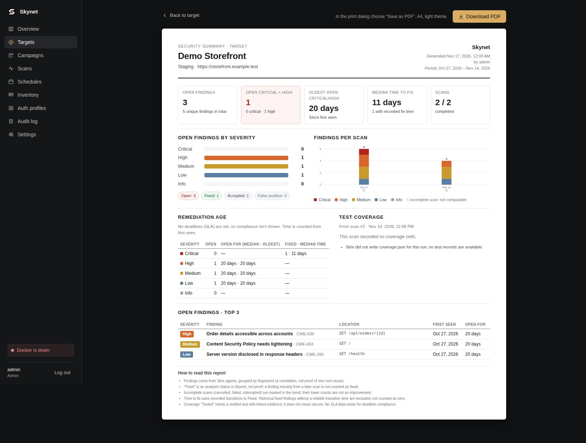

# Skynet

Skynet, uygulamaları production'a çıkmadan önce ve sonrasında düzenli aralıklarla pentestten geçirmek için
kullanılan web tabanlı yönetim arayüzüdür. Pentest motoru olarak makinede kurulu **[Strix](https://github.com/usestrix/strix)**
CLI'ını kullanır; Strix'i yeniden yazmaz, yalnızca taramaları başlatır, izler, zamanlar ve sonuçlarını gösterir.

Arayüz dili İngilizce, varsayılan saat dilimi **Europe/Istanbul**. FastAPI, SQLite ve harici CDN gerektirmeyen
bir web arayüzüyle çalışır.

[Ekran görüntüleri](#ekran-görüntüleri) · [Kurulum](#kurulum) · [RHEL rehberi](docs/RHEL.md) ·
[Nginx / HTTPS](docs/NGINX.md) · [Test ve doğrulama](#test-ve-doğrulama)

## Ekran görüntüleri

17 Kasım 2026'da güncel uygulamadan alınan görüntülerdir. **Hedefler, tarama geçmişi ve bulgular ayrı bir
demo veritabanındaki örnek kayıtlardır; gerçek müşteri verisi veya canlı tarama sonucu değildir.**
Görüntüler 1600 × 1050 tarayıcı penceresinde alındı; raporun tamamı gösterilir.

**Hedef detayları:** bulgu grupları, tarama geçmişi, kapsam ve kimlik profilleri tek sayfada.



| Kampanya yönetimi | Keşif envanteri |
| --- | --- |
| [](docs/screenshots/campaign.jpg) | [](docs/screenshots/inventory.jpg) |
| Birden fazla hedefi aynı çalışma altında takip edin. | Varlıkları tür, kapsam ve kanıt düzeyine göre filtreleyin. |

| Kimlik profilleri / Vault | Denetim kaydı |
| --- | --- |
| [](docs/screenshots/auth-profiles.jpg) | [](docs/screenshots/audit-log.jpg) |
| Kimlik profillerini hedeflere atayın; sırlar listede gösterilmez. | İşlemleri kullanıcı ve eyleme göre inceleyin. |

<details>
<summary>Yönetim raporu: bulgu eğilimi, açık kalma ve düzeltme süreleri</summary>

Hedef veya kampanya için özet oluşturun; **Download PDF** ile tarayıcının yazdırma penceresinden kaydedin.



</details>

Görüntülerin kaynak sürümü ve kontrol bilgileri: [ekran görüntüsü notları](docs/screenshots/README.md).

## Özellikler

- Hedef yönetimi: uygulama, adres, ortam (development / test / staging / production), kapsam içi/dışı
- **Kampanyalar:** birden çok hedefi, taramayı ve zamanlamayı tek angajman altında toplama; bulgu aday grupları özeti
- **Kimlik profilleri (vault):** yeniden kullanılabilir kimlik doğrulama (anonim / kullanıcı+şifre / başlık / çerez); sırlar şifreli saklanır ve taramaya yalnızca sandbox dosyası olarak verilir, talimata yazılmaz
- **Keşif envanteri:** taramalarda bulunan host, servis, uç nokta ve teknolojiler; kanıt düzeyi (gözlemlendi / ajan bildirdi), kapsam etiketi ve tarama arası değişim
- **Tarama telemetrisi:** model çağrısı, yeniden deneme (oran limiti/zaman aşımı/bağlantı), gecikme, maliyet kaynağı, token ve ajan başına araç kullanımı
- Anlık tarama, kuyruk, canlı log ve ajan durumu, güvenli durdurma (alt süreçler ve sandbox konteyneri dahil)
- Zamanlama: tek seferlik, günlük, haftalık, saat aralıklı ve cron; duraklat / etkinleştir / düzenle / sil
- Tarama geçmişi, bulgu aday grupları (giderilme durumu), Strix raporları, SARIF/CSV/JSON/Markdown indirme
- LLM bağlantı profilleri: OpenRouter ve kurum içi LiteLLM, kod değişikliği olmadan geçiş
- Prod öncesi CI kullanımı için token korumalı API (bulgu eşiği: pass/fail)
- **Kanıt görünümleri (SKY-01…07):** tarama karşılaştırması, ajan bazında oturum sağlığı, kanıta bağlı kapsam
  matrisi (endpoint × rol × WSTG test türü), talimat merkezi, zaman çizelgesi ve replay, tarayıcı görünümü
  (yalnız metadata), bulgu kanıt çalışma alanı (maskeli fark, analist notları)

Tüm Strix çıktıları (log, rapor, bulgu, yönetici özeti, indirmeler) gösterilmeden önce kimlik profili sırlarına
ve bilinen gizli desenlere karşı maskelenir.

## Kurulum

Gereksinimler: Python 3.10+ (Skynet), Python 3.12–3.14 (Strix), çalışır durumda Docker (Strix sandbox'ı).
Strix motoru repoyla birlikte gelir (`vendor/strix/`, resmi `strix-agent` 1.7.0, Apache-2.0); ayrıca kurmak gerekmez.

```bash
git clone https://github.com/wiemBe/Strix-Skynet.git && cd Strix-Skynet
cp .env.example .env      # gerekirse düzenleyin
./run.sh                  # http://127.0.0.1:8787
```

RHEL 9.4+ x86_64 için servis kurulumu, veri/anahtar taşıma ve kabul kontrolleri: **[docs/RHEL.md](docs/RHEL.md)**.

`run.sh` ilk çalıştırmada `.venv` oluşturup `requirements-app.lock` bağımlılıklarını, ardından
`scripts/setup_strix.sh` ile Strix'i `.strix-runtime/` içine kurar: wheel'in SHA-256'sı doğrulanır ve test edilmiş
bağımlılık kilidi (`vendor/strix/requirements.lock`) kullanılır. Bağımlılıklar PyPI'dan indirilir; sandbox imajını
Strix ilk taramada Docker ile çeker. Resmi wheel'ler Linux x86_64 ve macOS Apple silicon için paketlenmiştir;
kurucu işletim sistemi/mimariye göre seçer. Diğer platformlarda ayrı bir Strix kurulumu gerekir. Yeni kurulumda Settings'teki Strix yolu varsayılan olarak bu paketlenmiş motordur;
var olan kurulumların ayarı değişmez. Yeniden kurmak için: `scripts/setup_strix.sh --force`.

**Giriş:** `SKYNET_USER` (varsayılan `admin`) yerleşik yönetici hesabıdır; her zaman etkin bir admin'dir ve arayüzden
düzenlenemez/silinemez. `.env` içinde `SKYNET_PASSWORD` boşsa ilk açılışta rastgele bir şifre üretilir ve
`data/admin_password.txt` dosyasına (0600) yazılır; şifre Settings > Your account bölümünden değiştirilebilir.
`SKYNET_PASSWORD` doluysa şifre ortamdan gelir ve arayüzden değiştirilemez.

### İlk kullanım

1. **Settings > LLM connections** bölümünde OpenRouter veya LiteLLM bağlantısını ekleyip varsayılan seçin.
2. **Targets > New target** ile yetkili olduğunuz hedefi, ortamını ve kapsam sınırlarını tanımlayın.
3. Kimlik doğrulama gerekiyorsa **Auth profiles** bölümünden profil oluşturup hedefe atayın.
4. Hedefte **Scan now** ile tarama başlatın veya **Add schedule** ile zamanlayın; sonuçları hedef ve tarama detayından izleyin.

## Kullanıcılar, roller ve denetim kaydı

Ağdan sunucu IP'siyle erişim: [aynı RHEL sunucusunda Nginx kurulumu](docs/NGINX.md).
Nginx 80/443'te, Skynet `127.0.0.1:8787`'de çalışır. HTTP/HTTPS, istemci CIDR allowlist'i ve dry-run kurucu vardır;
gerçek sunucuya uygulanmış kabul edilmez.

Admin, Settings > Users bölümünden ek hesap açar. Üç rol vardır:

| Rol | Yetki |
|---|---|
| Viewer | Salt okuma: taramalar, bulgular, envanter, raporlar |
| Analyst | Viewer + tarama başlatma/durdurma/sürdürme, ajana talimat, bulgu doğrulama ve durum/not/etiket, hedef/zamanlama/kampanya oluşturma ve düzenleme |
| Admin | Analyst + ayarlar, LLM bağlantıları, kimlik profilleri (sırlar), silme işlemleri, kullanıcılar, denetim kaydı, CI token |

- Yetki sunucuda tek bir tablodan uygulanır (`skynet/audit.py` `RULES`). Listede olmayan değiştirici bir uç nokta
  varsayılan olarak yalnız admin'e açıktır; arayüzde yetkisiz düğmeler gizlenir ama asıl kontrol sunucudadır.
- Rol ve hesap durumu her istekte veritabanından okunur: rol değişikliği mevcut oturuma hemen uygulanır; devre dışı
  bırakma, şifre sıfırlama veya şifre değişikliği kullanıcının açık oturumlarını sonlandırır. Devre dışı bırakılıp
  yeniden açılan hesapta eski çerezler tekrar geçerli olmaz; kullanıcı yeniden giriş yapar.
- Son etkin admin kaldırılamaz; kimse kendi rolünü düşüremez, kendini devre dışı bırakamaz veya silemez.
- **Audit log** (yalnız admin): giriş/çıkış ve başarısız girişler (yalnız var olan kullanıcı adları kaydedilir), her
  değiştirici API çağrısı (kim, ne, hangi nesne, sonuç, IP), reddedilen denemeler (403), zamanlayıcı ve CI token ile
  başlatılan taramalar, rapor görüntülemeleri. İstek gövdesi asla saklanmaz (sırlar, şifreler, talimat metni);
  yalnız sır içermeyen kısa özetler (ör. bulgu durumu `open → fixed`). Kayıt eklemeli tutulur; arayüzde silme yoktur.
- Mevcut kurulumlar migration 6 ile taşınır: üretilmiş admin şifresi kullanıcı tablosuna aktarılır (öncesinde yedek alınır).
- Migration 7, kalıcı oturum iptal sürümünü ve güvenilir `fixed_at` zamanını ekler; zaten kapalı hesapların eski
  oturumlarını da iptal eder. Eski audit metadata'sındaki bilinen tam sır değerleri aynı migration transaction'ında
  maskelenir; olay kimliği, zamanı ve sonucu korunur. Bu, eklemeli kayıt politikasının gizlilik onarımı istisnasıdır.
  Önce tutarlı SQLite yedeği alınır; mevcut anahtar değiştirilmez. Önceki yedekler yeniden yazılmaz ve düzeltme öncesi
  metadata içerebilir. Sonradan öğrenilen sırlar audit okunurken de maskelenir.

## SIEM / Syslog

Admin, **Settings → SIEM / Syslog** bölümünden UDP/TCP/TLS collector'ını tanımlayabilir; isteğe bağlı mTLS
sertifika yolları desteklenir. RFC 5424 + JSON audit metadata'sı, kalıcı outbox ve artan retry ile gönderilir.
Test olayı ve pending/handoff/overflow/hata durumu görünür. Varsayılan kapalıdır; eski audit geçmişi topluca
gönderilmez. Handoff SIEM ingestion onayı değildir; `event_id` ile deduplication gerekir.
[Kurulum, alanlar ve teslim sınırları](docs/SYSLOG.md).

## Yönetim raporu

Hedef veya kampanya sayfasındaki **Report** düğmesi bir özet açar (her rol görebilir): veriye dayalı yönetici
özeti ve öncelikli aksiyonlar, açık bulgular (önem derecesine göre), tarama başına bulgu eğilimi, açık bulguların
yaşı ve düzeltme süresi, test kapsamı, en önemli 6 açık bulgu.

- **Summary report / Detailed report:** ayrıntılı görünüm, güncel kapsam kurallarını ve tüm durumlarıyla
  eksiksiz bulgu listesini ekler. Her bulguda hedef/host, endpoint, CWE, ilk/son görülme, analist notu ve bu
  seçime ait görülme sayısı/kaynak taramalar bulunur. Güncel kapsam ve bulgu durumları tarihsel snapshot değildir.
- **Download PDF:** seçilen görünümü tarayıcının yazdırma penceresine gönderir; "PDF olarak kaydet" seçilir
  (A4, açık tema; ek Python bağımlılığı yoktur, Türkçe karakterler korunur). Ayrıntılı ek yeni sayfadan başlar;
  raporun uzunluğu içeriğe göre değişir.
- **Markdown:** kapsam, yönetici özeti, metrikler, kapsam kanıtı özeti ve tüm bulgu listesiyle düzenlenebilir
  `.md` raporu indirir. API: `GET /api/targets/{id}/report?format=markdown` veya
  `GET /api/campaigns/{id}/report?format=markdown`. Varsayılan yanıt JSON'dır; her iki biçim de aynı rol ve audit
  kontrolünden geçer, sırlar maskelenir.

Raporun başlık, hedef/kampanya metadata'sı ve hazırlayan adı dahil tüm metinleri güncel Vault değerleri ve
saklanan tarama maskeleme verileriyle korunur. Düzeltme süresi yalnız kaydedilmiş **Fixed durumuna geçiş**
zamanından hesaplanır; not düzenlemek bu zamanı değiştirmez. Eski `remediation_at` alanının gerçek geçiş mi
yoksa son not düzenlemesi mi olduğu belirlenemediğinden bu alan `fixed_at` için doldurulmaz. Güvenilir zamanı
olmayan fixed kayıtlar sayılmaya devam eder, fakat süre istatistiğinden çıkarılır; raporda eksik sayı açıklanır.

- Skynet'te düzeltme son tarihi (SLA) olmadığı için "son tarihe uyum" gösterilmez; yerine açık kalma süresi ve
  "ilk görülme → fixed işaretlenme" süresi gösterilir.
- İptal edilen, başarısız veya yarıda kalan taramalar eğilimde "incomplete" olarak işaretlenir; düşük sayıları
  iyileşme sayılmaz. Doğrulama çalışmaları eğilime girmez. Kapsam, adı verilen tek bir tamamlanmış taramadan gelir.
- Özet metrikler saklanan tüm seçili taramaları kapsar; grafik son 12 bitmiş değerlendirme taramasını gösterir.
  Kampanyadan çıkarılmış hedeflerin kampanyaya ait eski taramaları hedef tablosunda da hesaba katılır.
- Gelecekteki ilk görülme veya ters tarih sırası sıfır gün olarak gösterilmez; belirsiz süreler metrikten çıkarılır.
- Bulgu metinleri diğer bulgu yanıtları gibi vault maskelemesinden geçer.

**İlk açılış:** `~/.strix/cli-config.json` içinde OpenRouter ayarı varsa otomatik olarak şifreli bir
"OpenRouter" LLM profiline dönüştürülür. Daha önce Strix TUI ile yapılmış taramalar `strix_runs/` klasöründen
içe aktarılır.

## Yapılandırma

Süreç düzeyindeki ayarlar `.env` / ortam değişkenleriyle verilir (tamamı için `.env.example`):

| Değişken | Varsayılan | Açıklama |
|---|---|---|
| `SKYNET_HOST`, `SKYNET_PORT` | `127.0.0.1`, `8787` | Ağa açarken TLS'li bir reverse proxy arkasında çalıştırın |
| `SKYNET_USER`, `SKYNET_PASSWORD` | `admin`, (üretilir) | Giriş bilgileri |
| `SKYNET_SECRET_KEY` | — | Gizli değerlerin şifreleme anahtarı (Fernet); dosya yerine doğrudan verilebilir |
| `SKYNET_SECRET_KEY_FILE` | `~/.config/skynet/secret.key` | Şifreleme anahtarı dosyası (bilerek `SKYNET_DATA` **dışında**) |
| `SKYNET_COOKIE_SECURE` | `0` | HTTPS arkasında `1` yapın |
| `SKYNET_TIMEZONE` | `Europe/Istanbul` | Zamanlamaların varsayılan saat dilimi |
| `SKYNET_DATA` | `./data` | SQLite veritabanı, süreç logları, geçici çalışma dosyaları |
| `SKYNET_STRIX_BIN`, `SKYNET_STRIX_WORKDIR` | Otomatik binary keşfi, yazılabilir kullanıcı dizini | Otomatik modun ortam override'ları; Settings'teki manuel yol önceliklidir |
| `SKYNET_STRIX_PYTHON` | ilk bulunan python3.12/3.13/3.14 | Paketlenmiş Strix'in kurulacağı Python |

Strix binary yolu, çalışma klasörü, eşzamanlı tarama limiti, Strix telemetrisi ve webhook adresi
**Ayarlar** sayfasından yönetilir.

**Strix yolları otomatik seçilir.** Binary için sıra: `SKYNET_STRIX_BIN` → projedeki
`.strix-runtime/bin/strix` → `~/.strix/bin/strix` → `PATH` üzerindeki `strix`. Ortam override'ı dışında
yalnız çalıştırılabilir dosyalar seçilir. Çalışma klasörü `SKYNET_STRIX_WORKDIR`, yoksa uygulamayı
çalıştıran kullanıcının yazılabilir home dizinidir; home uygun değilse `SKYNET_DATA/work` kullanılır
(ilk taramada oluşturulur). Sunucuda bu kullanıcı, tarayıcıdaki kullanıcı değil servis hesabıdır.

Settings > Strix runtime environment içindeki **Strix binary** ve **Working folder** boş bırakılırsa
otomatik seçim her okumada yeniden çözülür. Elle yol girerek alanları birbirinden bağımsız override
edebilirsiniz; ekranda otomatik aday ve geçerli seçimin kaynağı görünür. **Use automatic paths → Save**
iki alanı otomatiğe döndürür. Yeni kurulumlar otomatik başlar; eski kayıtlı yollar manuel override olarak
korunur. Bulunamayan açık bir override sessizce başka yola geçmez. Çalışan tarama varken çalışma klasörü
değiştirilemez. Bu özellik Strix'i indirip kurmaz veya eski sonuç dosyalarını taşımaz.

## LLM bağlantıları: OpenRouter, OpenCode Go ve LiteLLM

Skynet ayrı bir LLM katmanı kurmaz. Seçilen bağlantı profili, Strix'in kendi
[yapılandırma değişkenlerine](https://docs.strix.ai/advanced/configuration) çevrilir ve her tarama için
geçici bir `--config` dosyasıyla (0600, tarama bitince silinir) verilir:

| Profil alanı | Strix değişkeni |
|---|---|
| Model | `STRIX_LLM` (OpenRouter: `openrouter/<model>`, Go / LiteLLM: `openai/<model>`) |
| API anahtarı | `LLM_API_KEY` |
| Base URL | `LLM_API_BASE` |
| API tipi | `STRIX_API_TYPE` (gateway yalnızca chat completions destekliyorsa `chat_completions`) |
| Reasoning effort | `STRIX_REASONING_EFFORT` |
| Özel CA | `SSL_CERT_FILE` |
| Go oturumu | `LLM_EXTRA_HEADERS` (`User-Agent: Skynet-Strix/1.0`, tarama boyunca sabit `x-opencode-session`) |

**Kurum içine geçiş:** Settings > LLM connections > Add connection → Sağlayıcı "LiteLLM", base URL
`http://litellm.kurum.local:4000`, gerekiyorsa LiteLLM virtual key → otomatik gelen listeden gateway modelini
seçin → Save / **Make default**. Kod değişikliği gerekmez; OpenRouter profili kullanılabilir kalır.

**OpenCode Go aboneliği:** Settings > LLM connections > Add connection → Provider **OpenCode Go** →
bağlantıya bir isim ve Go API anahtarını girin. Base URL boş bırakılırsa
`https://opencode.ai/inference/go/openai/v1`, API type boşsa `chat_completions` kullanılır.
Anahtar alanından çıkınca Go model kataloğu otomatik yüklenir; listeden hesabınızda erişebildiğiniz modeli
seçin → Save. İsterseniz **Make default connection** seçin veya tarama/zamanlamada bu profili seçin.
Model adı yalın girilebilir; OpenCode'dan kopyalanan `opencode-go/` öneki de kabul edilir.

Go kontrolü yalnız model kataloğuna erişimi ölçer; anahtar geçerliliğini, çıkarım iznini veya kalan kotayı
doğrulamaz ve ücretli bir üretim isteği göndermez. Her tarama ayrı bir oturum kimliği kullanır; aynı run'ı
devam ettirirken kimlik korunur. Strix'in normal, compaction ve dedupe istekleri aynı LLM başlıklarını kullanır.
Sağlayıcı değiştirirken eski anahtar başka sağlayıcıya otomatik gönderilmez; yeni sağlayıcının anahtarını
yeniden girin. Go hatasında Zen/PAYG uç noktasına geçilmez; limitler ve ekstra kullanım ücretleri OpenCode
hesap ayarlarınıza bağlıdır. [Go aboneliği](https://opencode.ai/docs/console/go/) ve
[diğer istemciler için resmî API/oturum gereksinimleri](https://opencode.ai/docs/console/harnesses/).

**Model seçimi (üç sağlayıcı):** Kayıtlı bağlantının **Change model** düğmesi doğrudan model aramasına
odaklanır ve güncel kataloğu getirir. Yeni bağlantıda sağlayıcı/URL/anahtar alanları tamamlanıp alandan
çıkıldığında liste yüklenir; **Refresh models** ile elle yenilenebilir. Arama model adlarını yerelde filtreler;
200'den fazla eşleşmede aramayla diğer modellere ulaşılır. Listeden seçim Model alanını ve Strix model
önizlemesini günceller. Model alanı boş ve katalogda yalnız bir model varsa otomatik seçilir; mevcut/özel
model kimliği kendiliğinden başka modele çevrilmez. Model listede yoksa uyarı görünür ve elle girilebilir.

OpenRouter kataloğu anahtarsız okunur; katalogda görünmek hesap erişimi veya model yeteneği garantisi
değildir. Otomatik model sorguları çıkarım isteği göndermez. Sağlayıcı/adres değişince eski liste temizlenir;
kayıtlı anahtar otomatik sorguyla başka adrese gönderilmez. **Save**, bağlantının modelini kuyruktaki ve
gelecek taramalar için değiştirir; çalışan süreç model değiştirmez. Tarama başlarken kullanılan gerçek
model/provider adı geçmiş kaydına yazılır.

Güvenlik kuralları:
- API anahtarları veritabanında şifreli saklanır, tarayıcıya hiçbir zaman gönderilmez, loglara yazılmaz.
- Her tarama ve zamanlama, kaydedildiği bağlantı profilini kullanır. Profil hata verirse **başka profile otomatik geçilmez**.
- Skynet'in kendi ortamındaki `OPENAI_API_KEY`, `LLM_API_BASE` gibi değişkenler Strix sürecine aktarılmaz; böylece veriler
  yanlışlıkla başka bir sağlayıcıya gitmez.
- Strix telemetrisi (`STRIX_TELEMETRY`) varsayılan olarak **kapalı** başlatılır (Strix'in kendi varsayılanı açıktır).

## Kampanyalar, kimlik profilleri, envanter ve telemetri

- **Kampanyalar** yalnızca gruplamadır: hedefleri, taramaları ve zamanlamaları bir angajman altında toplar ve
  bulgu aday grupları özetini gösterir. Taramanın nasıl çalıştığını değiştirmez. Kampanya silme yalnızca arşivlenmiş
  kampanyada mümkündür ve sadece bağlantıları koparır; taramalar, bulgular ve zamanlamalar korunur.
- **Kimlik profilleri** hedeflere atanır; bir tarama yalnızca atandığı profilleri kullanabilir. Profil silinir veya bir
  hedeften kaldırılırsa onu kullanan zamanlamalar otomatik duraklatılır ve bir olay kaydı yazılır (sessizce kimlik
  doğrulamasız çalışmaz). Sırlar türetilmiş bir anahtarla ayrıca şifrelenir; her taramaya başlarken kullanılan değerler
  şifreli bir anlık görüntü olarak saklanır, böylece profil sonradan değişse bile eski taramalardaki maskeleme bozulmaz.
- **Bulgular** host + yöntem + normalize uç nokta + CWE parmak iziyle aday gruplara ayrılır. Bu eşleşme tek başına aynı açık olduğunun kanıtı değildir. Her görülme kendi taramasına bağlı
  kalır (devam ettirilen tarama iki kez saymaz). Giderilme durumu (açık / giderildi / kabul edildi / hatalı pozitif) elle
  işaretlenir; "giderildi" bir bulgu sonraki taramada yine görülürse sessizce yeniden açılmaz, işaretlenir.
- **Envanter** yalnızca Strix'in gerçekten kaydettiğinden oluşur: Caido proxy kayıtları ve bulgular "gözlemlendi",
  coverage/threat-model etiketleri "ajan bildirdi" düzeyindedir. Teknoloji yalnızca yanıt başlıklarından çıkarılır.
  Keşfedilen hiçbir şey hedefin kapsamını değiştirmez; kapsam etiketi yalnızca okuma anında hesaplanır.
- **Telemetri** `strix.log` ve `run.json`'dan artımlı okunur. Tamamlanan istek `run.json`'dan, deneme sayısı ve yeniden
  denemeler (oran limiti / zaman aşımı / bağlantı) logdan gelir. Maliyet, sağlayıcı bildirdiyse onun değeridir; yalnızca
  LiteLLM tahmini varsa "tahmin", hiçbiri yoksa "Strix hesaplayamadı" olarak etiketlenir. Eksik veri sıfır değil "veri yok"
  gösterilir. Araç çağrıları `agents.db`'deki araç adlarından ajan bazında sayılır.

## Şifreleme anahtarı ve veri taşımaları

Şifreleme anahtarı artık veri klasörünün **dışında** (`~/.config/skynet/secret.key`, `SKYNET_SECRET_KEY_FILE` ile
değiştirilebilir) tutulur; böylece `data/` klasörünün bir kopyası (veritabanı yedekleri, destek paketleri) tek başına
hiçbir sırrı çözemez. Daha önce `data/secret.key` konumunda üretilmiş anahtar ilk açılışta yeni konuma taşınır
(kopyalanır, doğrulanır, sonra silinir); anahtar asla yeniden üretilmez.

Şema değişiklikleri numaralı taşımalarla uygulanır (`schema_migrations` tablosu); ilk bekleyen taşımadan önce veritabanı
`data/backups/` altına yedeklenir. İlk taşıma, hedeflerde tutulan eski satır içi kimlik bilgisini bir kimlik profiline
taşır, profili hedefe ve o hedefin zamanlamalarına bağlar ve geçmiş taramalara maskeleme anlık görüntüsü ekler. Anahtar
konumu ve uygulanan taşımalar **Ayarlar** sayfasında görünür.

## Zamanlama kuralları

- Planlar SQLite'ta saklanır; uygulama her açılışta işleri yeniden kurar, planlar kaybolmaz.
- **Kaçırılan çalıştırmalar:** Uygulama kapalıyken zamanı 5 dakikadan fazla geçen çalıştırma geriye dönük başlatılmaz.
  "Kaçırıldı" olarak kaydedilir ve plan bir sonraki zamandan devam eder. Kaçırılan tek seferlik plan kapatılır.
- **Çakışma:** Aynı hedefte aktif (kuyrukta / çalışan) tarama varken yeni tarama başlatılamaz; zamanlama o çalıştırmayı "Atlandı" olarak kaydeder.
- **Hata durumunda:** Başarısız taramalar otomatik tekrarlanmaz.
- **Devam eden taramalar ve yeniden başlatma:** Strix ayrı bir süreç oturumunda çalışır. Skynet yeniden başlarsa
  hâlâ çalışan Strix süreçlerine yeniden bağlanır. Süreç ölmüşse tarama "Yarıda kaldı" olarak işaretlenir,
  artık sandbox konteyneri temizlenir ve tarama **otomatik yeniden başlatılmaz**. Kullanıcı isterse "Kaldığı yerden devam et"
  ile `strix --resume` çalıştırabilir. Kuyrukta bekleyen (hiç başlamamış) taramalar açılışta sırayla başlatılır.

## Durdurma

"Durdur" önce Strix süreç grubuna `SIGINT` gönderir; Strix raporunu yazar ve sandbox'ı kapatır. 45 saniyede kapanmazsa
`SIGTERM`, ardından `SIGKILL` gönderilir. Son olarak Strix logunda kayıtlı sandbox konteyneri hâlâ çalışıyorsa
`docker rm -f` ile kaldırılır (yalnızca o taramaya ait konteyner).

## CI / pipeline

Settings > CI / pipeline access bölümünden token oluşturun (yalnızca bir kez gösterilir).

```bash
SCAN=$(curl -s -X POST -H "X-API-Token: $SKYNET_TOKEN" "$SKYNET_URL/api/ci/targets/<hedef_id>/scan" | jq -r .scan_id)
while :; do
  R=$(curl -s -H "X-API-Token: $SKYNET_TOKEN" "$SKYNET_URL/api/ci/scans/$SCAN")
  [ "$(echo "$R" | jq -r .finished)" = "true" ] && break; sleep 60
done
[ "$(echo "$R" | jq -r .gate)" = "pass" ] || exit 1
```

`gate`, taramadaki "bulgu eşiği" (Strix `--fail-on`) seviyesinde veya üzerinde bulgu varsa `fail` döner.

## Strix kaynaklı sınırlamalar

- **Kapsam:** Strix'te kapsam (izinli/yasaklı host) için ayrı bir seçenek yoktur. Skynet kapsamı Strix'in belgelenmiş
  yöntemi olan talimat dosyasıyla (`--instruction-file`) iletir; kapsam teknik olarak zorlanmaz, ajanlardan uyması istenir.
- **Kimlik doğrulama:** Strix'in kendi kimlik doğrulama seçeneği yoktur. Skynet gizli değerleri talimata **yazmaz**; her
  kimlik profilini 0600 bir dosyaya yazıp `--workspace-file` ile sandbox içindeki `/workspace/skynet_auth/` altına kopyalatır
  (tarama bitince host'taki dosya silinir). Talimatta yalnızca profil adı, yöntem, gizli olmayan bilgiler (kullanıcı adı,
  başlık/çerez adları) ve dosya yolu geçer; ajanlardan dosyayı referansla kullanması istenir (`curl -H @dosya`). OAuth/token
  yenileme, MFA/TOTP ve istemci sertifikası (mTLS) sunulmaz çünkü bu primitiflerle çalışmazlar. **Strix girişin başarılı olup
  olmadığını bildirmez;** Skynet yalnızca başlık/çerez profilleri için kendi ön kontrolünü (tek HTTP isteği) ayrıca yapar.
- **İlerleme:** Strix yüzde bazlı ilerleme bildirmez. Skynet süreyi, canlı logu, ajan durumlarını ve tarama sırasında yazılan
  bulguları gösterir; yüzde veya ilerleme çubuğu uydurmaz.
- **Ön bulgular:** Tarama sürerken bulgular `vulnerabilities/*.md` dosyalarından okunur ve "ön bulgu" olarak işaretlenir.
  Nihai liste tarama sonunda `vulnerabilities.json`'dan gelir.
- **Maliyet:** Strix model fiyatını bilmediğinde `run.json` içine `0` yazar; Skynet bunu "Strix bildirmedi" olarak gösterir.
- **Kullanılan model:** `run.json` modeli içermez. Skynet modeli kendi kaydından, içe aktarılan TUI taramalarında `strix.log`'daki
  "LLM model resolved" satırından alır.
- **Sandbox konteyneri:** Strix konteynerleri taramaya özel etiketlemez. Temizlik, Strix logundaki konteyner kimliği üzerinden yapılır.

## Proje yapısı

```
skynet/
  main.py          FastAPI uygulaması: REST API, oturum, CSRF, CSP, maskeleme, statik arayüz
  runner.py        Strix süreçleri: kuyruk, başlatma, izleme, durdurma, yeniden bağlanma, içe aktarma, ingest, webhook
  scheduler.py     Zamanlamalar (APScheduler), kaçırılan çalıştırma politikası
  llm.py           LLM profilleri → Strix ortam değişkenleri, bağlantı testi, model listesi
  targets.py       Hedef → Strix hedefleri ve talimat dosyası
  campaigns.py     Kampanyalar (gruplama, arşiv, bulgu özeti)
  vault.py         Kimlik profilleri: doğrulama, --workspace-file üretimi, ön kontrol, maskeleme
  findings_store.py Bulgu parmak izi ve tekilleştirme, giderilme durumu
  inventory.py     Keşif envanteri: Strix çıktılarından host/servis/uç nokta/teknoloji çıkarımı
  telemetry.py     Tarama telemetrisi: strix.log + run.json + agents.db artımlı okuma
  redact.py        Gizli değer ve desen maskeleme
  scope.py         URL/host normalizasyonu ve kapsam etiketleme
  runs.py          strix_runs/<run> klasörünü okuma (run.json, bulgular, ajanlar, log)
  activity.py      Live activity: agents.db'den artımlı, maskeli ajan mesajı / araç akışı
  verify.py        Bulgu doğrulama çalışmaları ve muhafazakâr kanıt sınıflandırması
  control.py       Canlı ajana mesaj: başlatıcı seçimi, yerel kontrol ucu, şifreli denetim kaydı, durumlar
  strix_bridge.py  Strix runtime'ında çalışan ince başlatıcı (resmi CLI + mesaj kanalı; yalnızca stdlib import)
  auth.py          Kullanıcı hesapları ve roller, giriş, oturum çerezi, CI token
  audit.py         Uç nokta → gereken rol tablosu ve eklemeli denetim kaydı
  report.py        Hedef/kampanya yönetim raporu verisi (yazdırılabilir sayfa)
  crypto.py        Gizli değerlerin şifrelenmesi (anahtar veri klasörü dışında; vault alt anahtarı)
  db.py            SQLite şeması ve numaralı taşımalar
  static/          Bağımlılıksız arayüz (harici CDN yok; kurum içi ağda çalışır)
tests/             Birim ve API testleri; tests/runtime/ Strix runtime'ında çalışan gerçek koordinatör kontrolleri
```

## Test ve doğrulama

Kurulumdan sonra uygulama ortamında testleri çalıştırın:

```sh
.venv/bin/python -m unittest discover -s tests -v
node tests/test_frontend.cjs
```

Testler geçici veri dizinleri kullanır; gerçek `data/` klasörüne dokunmaz. Native Strix testlerinin de çalışması
için `.strix-runtime` kurulu olmalıdır; yoksa bu testler açıkça atlanır.

17 Kasım uygulama kodu incelemesi: **246 Python + 2 Node testi geçti** (macOS). Log/kanıt sınırlarında maskeleme,
resume geçmişi, kapsam portları, eksik çıktıda CI kapısı, kampanya geçmişi ve asenkron ekran yarışları düzeltildi.
[Ayrıntılı bulgular, değişiklikler ve kalan sınırlar](docs/reviews/2026-11-17-application-code-review.md).

**Son backend doğrulaması:** Red Hat UBI 9 x86_64 / Python 3.12.15 üzerinde **193 test geçti**, native Strix
testleri atlanmadı. Gerçek Nginx HTTP/HTTPS, giriş/CSRF, IP kısıtları ve uygulama yeniden başlatma sonrası
şifreli veri kalıcılığı da doğrulandı. [Test kanıtları ve tekrar komutları](docs/qa/2026-11-16-rhel-codex/README.md).
UBI testi gerçek RHEL sunucusunda systemd, SELinux, firewalld ve Docker sandbox kabulünün yerini tutmaz.

Geliştirme ve doğrulama takibi: [PROGRESS.md](PROGRESS.md). Özelliklerin kabul ölçütleri:
[FEATURE_BACKLOG.md](docs/FEATURE_BACKLOG.md).

Yalnızca yetkili olduğunuz sistemleri tarayın.


## Live activity ve bulgu doğrulama

**Live activity** tarama detayında görünür ajan mesajlarını ve araç çağrısı/yanıtlarını mevcut
`.state/agents.db` verisinden iki saniyede bir artımlı okur. Gerçek ajan hiyerarşisi sağdadır;
ajan seçimi akışı filtreler. Araç çağrısı ve yanıtı tek açılır kartta birleşir. Auto-follow kapatıldığında
okuma konumu korunur. Bağlantı kesilirse son kayıtlar görünmeye devam eder. Tamamlanmış taramalarda
bu alan açıkça **Recorded session** olarak etiketlenir. Reasoning öğeleri, kullanıcı promptları,
sağlayıcı metadatası ve ikili içerikler akışa alınmaz. Görünür metinler gönderilmeden önce maskelenir.

Bulgu detayındaki **Verify / Re-verify**, mevcut runner/kuyruk/iptal mekanizmasıyla ayrı ve odaklı bir
Strix çalışması oluşturur. LLM bağlantısı, güncel atanmış Vault profilleri, bütçe ve tur sınırı seçilebilir.
`finding_verifications`, bulgu grubu ve taramayla bağlantıyı; sır içermeyen profil sürüm/karşılaştırma
metadatasını; zamanları, sonucu ve kanıt referanslarını saklar. Kuyrukta profil yenilenirse başlangıçta
güncel sürüm okunur. Eski tarama sırları yalnızca maskelemede kullanılır, kimlik doğrulamada kullanılmaz.

- `reverified`: Bu çalıştırmaya ait saldırı/kontrol istekleri ve tam yanıtları, ilişkili Strix değerlendirmesi,
  yeni bulgu, yeni PoC/kanıt ve bulgunun `http_exchange_ids` bağlantısı birlikte doğrulanır.
- `not_reproduced`: İlgili testin tamamlandığı ve gereken oturum/erişimin test istekleri boyunca doğrulandığı
  gösterilir. Başlık/çerez profillerinde güncel kimlik materyali eşleşmesi ve korumalı kimlik belirteci aranır.
- `inconclusive`: Kanıt, tamamlanmış test, erişim veya oturum doğrulanamaz. Form-login sürekliliği mevcut
  kayıtlarla kanıtlanamıyorsa bu sonuç kullanılır. İptal/kesinti de negatif sonuç değildir.
- `error`: Çalışma teknik hatayla sonlanır.

Parmak izi eşleşmesi, tek endpoint isteği, HTTP 200/redirect, temiz çıkış veya başarılı Skynet ön kontrolü
tek başına yeterli değildir. Strix kanıt sözleşmesini tamamlamazsa değerlendirme `inconclusive` kalır.
Orijinal bulgu dosyaları ve observation kayıtları korunur; hiçbir sonuç giderilme durumunu otomatik değiştirmez.
Eski sınıflandırmalar önceki sonuç ve gerekçe korunarak yeniden değerlendirilebilir; tarama yeniden başlatılmaz.

Migration 2 doğrulama tablosunu, migration 3 ayrı kanıt alanını ve sınıflandırma sürümünü ekler. Her bekleyen
migration grubu öncesi SQLite backup API kullanılır; WAL verisi tutarlı yedeğe dahildir. Anahtar bulunamıyor
ama şifreli kayıtlar varsa yeni anahtar üretilmez. Anahtar konumu, şema sürümü ve migration yedek yolları
**Settings > Data protection** altında görünür.

## Canlı ajana mesaj

Çalışan bir taramada **Live activity** altındaki composer ile running/waiting durumdaki herhangi bir ajana
talimat gönderilebilir. Ağaçtan ajan seçmek composer hedefini de değiştirir; yazılan taslak 2 sn'lik
yenilemelerde silinmez.

**Nasıl çalışır.** Strix headless (`--non-interactive`) modda kullanıcı mesajı kabul etmez: native
`AgentCoordinator.send(from="user")` çalışan ajanı kesmeden `waiting` yapar, bütçe duraklatmasını açabilir ve
gelen kutusu yalnızca `wait_for_agents` ile okunur. Bu yüzden Skynet taramayı ayrı Strix runtime'ı
(`.strix-runtime/`, `strix-agent==1.7.0`) üzerinde `skynet/strix_bridge.py` ile başlatır. Köprü resmi Strix CLI
giriş noktasını aynen çalıştırır ve sürüme sabitlenmiş iki genel parametreye bağlanır:
`run_strix_scan(coordinator=...)` (ajan durumunu yalnızca okur) ve openai-agents
`RunConfig.call_model_input_filter`. Ajanın bir sonraki model çağrısından önce o ajana sıralanmış mesajlar
Strix oturumuna (agents.db) doğru sırada eklenir ve o çağrının girdisine konur. Ajan durumu, native mailbox
ve ajanlar arası mesajlaşma değiştirilmez. Mesaj başlığı, sistem promptundaki kapsam kurallarının geçerli
olduğunu ajana hatırlatır.

**Durumlar** yalnızca gözlenebileni söyler: `Sending`, `Queued for next model call` (Strix kabul etti),
`In agent context` (ajanın oturumuna ve model çağrısına eklendi), `Not delivered` (ajan veya tarama önce
bitti), `Rejected` (ajan aktif değil, bütçe duraklatması, kapanış, kuyruk dolu), `Unconfirmed` (zaman aşımı;
kabul edilmiş olabilir, otomatik yeniden gönderilmez). Ajanın talimatı uygulayıp uygulamadığı iddia edilmez;
bu activity akışında görülür. Bütçe sınırında duraklatılmış tarama mesajla sürdürülmez, bütçe değiştirilmez.

**Güvenlik.** Kontrol ucu yalnızca `127.0.0.1`, geçici port ve rastgele bearer token kullanır; Host başlığı
denetlenir. Port/token 0600 manifest dosyasındadır (`data/runtime/scan_<id>_control.json`); Skynet PID, protokol,
izinler ve sahipliği doğrular, yalnızca sabit host'a bağlanır ve yönlendirme izlemez. Süreç bitince manifest
silinir; durum dosyası içerik taşımaz. Skynet API'si oturum + CSRF ister. Mesajlar Vault anahtarıyla şifreli
`agent_messages` tablosunda saklanır, arayüzde taramanın maskeleme kurallarıyla gösterilir. `request_id`
ile idempotent: aynı ID tekrar gönderilirse köprü yinelemeyi reddeder, farklı içerik `409` döner.
Sırları mesaj yerine Vault profillerinde tutun.

**Uygunluk.** Köprü yalnızca runtime sürümü yapılandırılmış Strix binary sürümüyle aynıysa kullanılır
(motor sessizce başka sürüme geçmez). Değilse veya Settings'te kapalıysa tarama eskisi gibi binary ile başlar ve
composer gerekçeyi gösterir. Köprü eklenemezse (desteklenmeyen sürüm) Strix yine çalışır, mesajlaşma
kullanılamaz görünür. Runtime kurulumu: Python 3.12 ile `.strix-runtime` venv'i ve
`pip install strix-agent==<binary sürümü>`. Migration 4 `agent_messages` tablosunu ve
`scans.control_mode/control_note` alanlarını ekler (öncesinde yedek alınır).

Bu geliştirme oturumunun test kapsamı ve canlı motor çalıştırması sınırları [PROGRESS.md](PROGRESS.md)'dedir.

## Kanıt görünümü kuralları

Coverage hücreleri scheme + host + port + yöntem + normalize path ile ayrılır; origin her hücrede görünür.
İki HTTP kaydı veya ajanın “test ettim” beyanı tek başına `Tested` değildir. Bu durum için aynı taramanın
kabul edilmiş Skynet doğrulamasının ilgili kategori/endpoint/rol için tam kayıtlara bağlı olması gerekir.
Desteklenmeyen kategoriler `Partially tested` / `Unknown` kalır; hiçbir durum otomatik giderilme kararı vermez.

Timeline Vault değişince yeniden maskelenir. Canlı akış opak, sayfalanabilir alım cursor'u kullanır;
büyük partiler, geç gelen kayıtlar ve aynı olayın güncellemeleri işlenir. Replay başlangıç olayına güncel
coverage sonucunu geçmişten biliniyormuş gibi taşımaz. Çelişkili oturum sinyallerinin sırası kanıtlanamıyorsa
`Unknown` gösterilir. Ayrıntı ve 138 testlik son kontrol: [R1–R6 düzeltmeleri](docs/reviews/2026-11-15-sky-fixes.md).
